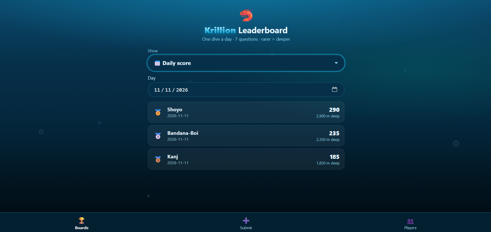

# Krillion Leaderboard



A shared leaderboard for friends who play **Krillion** (the daily dive game:
7 questions, answers score by rarity — Plankton 10 up to *One in a Krillion* 100,
game total out of 700, each point = 10 metres of depth).

- **Everyone with the link can see the leaderboards** — no login to view.
- **Friends submit their own results** — nobody has to type in anyone else's scores.
- Boards: 🏆 Highest score · 📈 Highest average · 🐌 Lowest score ·
  📉 Lowest average · 💎 Most One in a Krillions (tap a player to see the
  actual question and date for each hit).
- One result per player per day; re-submitting the same date updates it.
- Player cards show games played stats and full history; a wrong result can
  be deleted from the player's history.

No dependencies — Python 3 standard library only (SQLite database in `data.db`).

## Run it locally

```bash
python3 main.py
```

It listens on `$PORT` (default 8000).

## Put it online WITHOUT Replit (recommended — no phone number needed)

Replit asks for a phone number at signup, which is a problem if you don't want to use your phone number. These two hosts sign up with email only:

### Option A — PythonAnywhere (best for keeping scores safe)

PythonAnywhere's free Beginner plan signs up with just an email address,
its files persist (unlike Render's free tier, which wipes local files on
restart), and your site is `https://<yourusername>.pythonanywhere.com`.

1. Sign up at pythonanywhere.com (free Beginner plan, email only).
2. Easiest upload: on the Files tab, click "Upload a file" and upload this
   whole zip. Then open a Bash console (Consoles tab) and run:
   `unzip krillion-leaderboard-no-phone.zip`
   That creates `/home/<yourusername>/krillion-leaderboard/` with `main.py`,
   `wsgi.py`, and `static/` inside it. (Or upload those files one by one
   into that folder instead — create the `static/` folder first, then
   upload its 3 files into it.)
3. Go to the Web tab → Add a new web app → Manual configuration, Python 3.
4. In the Code section, click the WSGI configuration file link, delete
   what's there, and paste the contents of `pythonanywhere_wsgi.py` from
   this project — just replace YOURUSERNAME with your PythonAnywhere
   username. Do NOT paste `wsgi.py` itself there: PythonAnywhere's WSGI
   file lives in a different folder, so it needs this short version that
   points at your project folder.
5. Press Reload. Open `https://<yourusername>.pythonanywhere.com` — you
   should see the leaderboard.
6. Send that link to your friends. They open it on their phones, tap
   **Submit**, add their name once, and post their score after each dive.

Note: free PythonAnywhere sites need renewing monthly — log in and click
the "Run until 1 month from today" button before the expiry date shown on
the Web tab, still free.

### Option B — Glitch (fallback, also email signup)

1. Sign up at glitch.com with email or GitHub.
2. Create a new project and upload `main.py`, `glitch.json`, and `static/`.
3. Glitch runs `glitch.json`'s start command, which stores scores in
   `.data/data.db` — Glitch's folder that survives restarts.
4. Share your project's live URL (`https://<project>.glitch.me`) with friends.

## Why not Render's free tier?

Render also signs up without a phone, but its free services have an
ephemeral filesystem: files written locally (like our `data.db`) are lost
on redeploy/restart, and its free Postgres expires after 30 days. That
would eventually wipe the leaderboard, so it's not recommended for this app.

## Other hosts

Anything that can run `python3 main.py` and keep the `data.db` file
(Render with a paid disk, Railway, a VPS, etc.) also works — just keep
the deployed app on the same project, because `data.db` is where all
the results are stored. Don't delete it.
